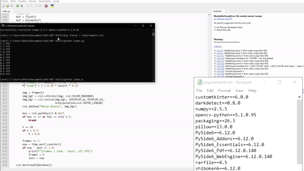

<div align="center">


<p align="center">
  
</p> 

<strong>Animación procedural de una flor Monja Blanca generada en tiempo real mediante partículas 3D, con iluminación, sombreado y efectos de bloom.</strong>

</div>

---

> [!NOTE]
> El proyecto utiliza una resolución interna fija (720×612) y reescala la ventana de visualización a 1080×918. El rendimiento puede variar según la CPU y la versión de OpenCV.

## Características

* **Renderizado por partículas:** Miles de partículas con superficie paramétrica tipo pétalo, muestreadas con densidad proporcional al ancho.
* **Animación por fases:** Crecimiento del tallo, apertura de la flor y desarrollo del estambre controlados mediante funciones de easing.
* **Z-buffer por capas:** Dos capas independientes (hojas/tallo y flor) con ordenamiento de profundidad y relleno morfológico de huecos.
* **Iluminación y sombreado:** Sombreado Lambertiano con luz direccional, oclusión ambiental y nervadura central en pétalos.
* **Bloom multi-nivel:** Efecto de resplandor mediante desenfoque gaussiano a múltiples escalas.
* **Cámara orbital:** Balanceo sinusoidal con inclinación elevada y zoom progresivo.

## Requisitos

* Python 3.11 o superior
* NumPy
* OpenCV (`opencv-python`)

## Instalación e inicio rápido

1. Clonar el repositorio:
   ```bash
   git clone https://github.com/Gh0zd/Monja-Blanca-Particles.git
   cd Monja-Blanca-Particles